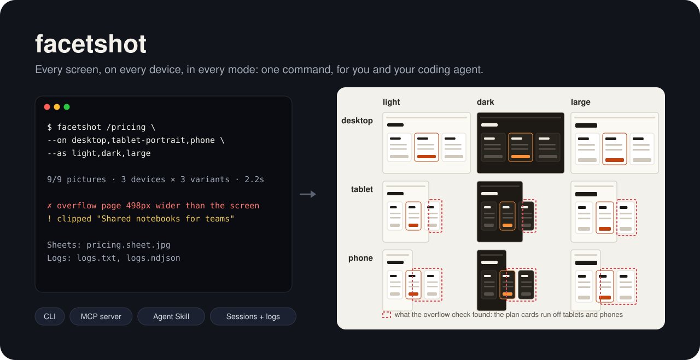
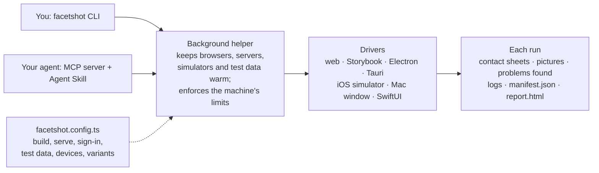

<p align="center">
  
</p>

# facetshot

**See every screen of your app on every device, in light, dark and large text, in one command. Made for working
with AI coding agents.**

facetshot takes pictures of web pages, iOS and Mac screens, Electron and Tauri windows, Storybook stories and SwiftUI
views across a grid of devices and display settings. You get back one contact sheet per screen, a short list of
what looks broken, and what the page and its servers logged. You can also keep a page open and work it step by
step (click, type, right-click) to see what happens.

> **Status: early (0.1).** facetshot isn't on npm yet, and its config may still change before 1.0. See
> [Installing before the npm release](#installing-before-the-npm-release).

## Why it exists

AI coding agents change UI code quickly, but they can't see the result unless something shows it to them. Checking a
change properly means looking at it on a phone, a tablet and a desktop, in light and dark mode and with large text:
a dozen pictures per screen. In practice, most of the time went into getting ready rather than looking. Agents
rewrote screenshot scripts, waited for builds and dev servers, signed in again, made test data and slept for a fixed
time in case the page wasn't ready yet. And several agents doing this at once could overload the machine.

facetshot collects those chores in one place, so that each look costs only the looking:

- **It keeps things warm.** A small background helper keeps the browser, your app's server and any simulators
  running between runs, so the second look takes seconds.
- **It waits for the screen, not the clock.** A picture is taken once the network is quiet, fonts are loaded and
  whatever your config says means "still loading" is gone.
- **It reads the screen.** Alongside the pictures it checks for sideways scrolling, cut-off text, buttons hidden under
  something else, broken images, console errors and failed requests, so you know which picture to look at.
- **It keeps what happened.** Each picture comes with the log of its page and of the servers behind it.
- **It shares the machine politely.** However many agents and terminals ask, there are at most four browser pages,
  two simulators and one heavy build at a time, and work slows down when the machine is busy.

## Built on, and alongside

facetshot stands on other people's work and doesn't try to replace it:

- **[Playwright](https://playwright.dev)** does all of facetshot's browser work: pages, device emulation, Electron,
  and the accessibility snapshots that tell an agent what it can click. facetshot adds the project around it (builds,
  servers, sign-in, test data, devices × variants) and puts the results together.
- **[Playwright MCP](https://github.com/microsoft/playwright-mcp)** gives an agent a browser to drive freely, with a
  rich set of tools. If you want an agent to browse the web or automate a site, use it. facetshot's sessions are
  narrower: they open _your_ app, already built, served and signed in, on a device and variant from your config,
  and can save what the agent did as a flow to picture on every device.
- **Visual regression services** (Chromatic, Percy, Argos and others) and **Playwright's `toHaveScreenshot`** guard
  approved screenshots in CI. facetshot is for the quick look while you work. Its baselines answer "what did my change
  do?" and aren't meant to gate merges.
- **Snapshot libraries** for native UI, like swift-snapshot-testing, keep reference images in tests. FacetshotKit
  only renders SwiftUI views for facetshot to show alongside the rest.

## What people use it for

- **Checking a UI change before calling it done.** An agent (or you) runs `check` on the screens a change touched,
  looks at the sheets for those with problems, fixes them, and compares.
- **Design review on every form factor.** One sheet per screen shows desktop, both tablet orientations and phone in
  light, dark and large text, side by side.
- **Reproducing a bug report.** "The menu is cut off on my phone in dark mode": open that page on `phone` as `dark`,
  right-click, and read the picture and the log.
- **Exploring a flow you don't know yet.** Work a page step by step in a session, then save the steps as a flow that
  runs on every device.
- **Seeing what a change did.** `facetshot diff` repeats the last command and shows only the screens that changed.
- **Comparing local work with what's live.** Picture production or staging, save it as a baseline, and compare your
  local build against it.
- **Pull request screenshots.** `--format md` writes a Markdown summary with the sheets.
- **Looking at apps outside the browser.** iOS simulators, Mac windows, Electron and Tauri apps, and SwiftUI views
  without launching the app.

## How it works



1. You (or your agent) name **targets** (`/settings`, `app:/inbox`, `story:button--primary`), **devices** (`phone`,
   `desktop`, `ipad-landscape`) and **variants** (`light`, `dark`, `large`, `dark+large`).
2. The **background helper** builds your app if its inputs changed, starts its servers, signs in, makes test data,
   and opens one browser context (or simulator) per device × variant. It stays up between runs and stops itself
   after 15 idle minutes.
3. Each **picture** is taken once the screen has settled, read by the checks, and stored with its log.
4. The **results** come back as a short summary, one contact sheet per screen, and files for people and programs.

The config is the only place that knows your project. With no config, facetshot can still picture any URL.

## Quick start

You need [Bun](https://bun.sh) 1.3 or newer: facetshot runs on Bun, whatever your app is built with. Web pages work on
macOS, Linux and Windows. iOS, Mac and SwiftUI need a Mac with Xcode.

```sh
bun add -d facetshot                 # once it's on npm; until then, see "Installing before the npm release"
bunx playwright install chromium     # facetshot uses Playwright's Chromium
```

Then start from whichever of these fits.

**Any page on the web.** No config needed:

```sh
bunx facetshot https://example.com --on phone,desktop
```

**Your own project.** Run `init` in the project's folder. It looks at what you already use (Vite, SvelteKit, Next.js,
Astro, Nuxt, Storybook, Electron, Tauri, Swift packages) and writes a `facetshot.config.ts` that builds and starts your
app:

```sh
bunx facetshot init
bunx facetshot / /settings
```

If the folder isn't a project it recognises, `init` writes nothing. It tells you what it looked for and what to do
next, so you never end up with a config that only fails later.

**An app that's already running.** Your dev server, staging or production:

```sh
bunx facetshot init --url https://staging.example.com
bunx facetshot /pricing /docs
```

`bunx facetshot doctor` checks what this machine has and gives the command that fixes anything missing.

## Connecting your coding agent

One command, run in your project's folder:

```sh
bunx facetshot init --agent claude    # or cursor, codex, all; add --yes to also write the line below
```

What it creates, and why:

| Agent       | File                                 | What it is                                                                                  |
| ----------- | ------------------------------------ | ------------------------------------------------------------------------------------------- |
| Claude Code | `.mcp.json`                          | registers facetshot's **MCP server** (a local stdio server) so the agent gets its tools     |
|             | `.claude/skills/facetshot/`          | the **Agent Skill**: `SKILL.md` says when to look and how; `reference.md` holds the details |
| Cursor      | `.cursor/mcp.json`                   | the same MCP server, for Cursor                                                             |
|             | `.cursor/rules/facetshot.mdc`        | the skill's text as a Cursor **rule**                                                       |
| Codex       | `.codex/config.toml`                 | the MCP server, under `[mcp_servers.facetshot]`; Codex reads it once you trust the project  |
|             | `.agents/skills/facetshot/`          | the Agent Skill, where Codex looks for a repository's skills                                |
| any         | `CLAUDE.md` or `AGENTS.md` (`--yes`) | one line: use facetshot to see screens, never a screenshot script of your own               |

- **The MCP server** gives the agent the tools below. It runs on your machine, talks to the background helper,
  and returns pictures as images in the tool result.
- **The skill** is plain Markdown that teaches the agent the routine: check first, look at what matters, fix,
  compare, and read the logs before guessing. Agents load it when a task is about UI.
- Existing entries in `.mcp.json` and the other files are kept, and `init` is safe to run again. Commit these files, and everyone on the team, and every agent, gets the same setup.

To check the connection, ask your agent "which facetshot tools do you have?" or "check /settings on a phone".

### MCP tools

| Tool      | What it does                                                  | Answers with                                             |
| --------- | ------------------------------------------------------------- | -------------------------------------------------------- |
| `check`   | reads screens for problems, without pictures                  | a list of problems (the cheapest call)                   |
| `capture` | pictures targets on the given or default devices and variants | a summary and one contact sheet per screen, as images    |
| `compare` | repeats the last capture (or the targets given) and compares  | only the sheets that changed                             |
| `inspect` | one picture at full size, or a region of it                   | the image, its problems and its log lines                |
| `list`    | devices, variants, profiles, checks, recent runs              | text                                                     |
| `open`    | opens a page and keeps it open: a session                     | its id, a picture, the log, what's on screen with refs   |
| `act`     | steps in a session: click, type, right-click, drag, scroll…   | the new picture, the log since the last step, fresh refs |
| `close`   | ends a session, optionally saving its steps as a flow         | text                                                     |

Each answer is text and images, and also structured data for clients that read it. See [AI agents](docs/agents.md).

## Commands

| Command                                    | What it does                                                              |
| ------------------------------------------ | ------------------------------------------------------------------------- |
| `facetshot <targets…> [--on …] [--as …]`   | takes pictures and prints a short summary                                 |
| `facetshot check <targets…>`               | reads the screens for problems, no pictures                               |
| `facetshot diff`                           | repeats the last command and shows what changed                           |
| `facetshot open <target> --on … --as …`    | opens a page to work step by step (a session)                             |
| `facetshot act <id> <step…>`               | does steps in a session, then shows it again                              |
| `facetshot look <id>` / `close <id>`       | shows a session again / closes it (`--save flows/x.yaml` keeps its steps) |
| `facetshot sessions`                       | lists open sessions                                                       |
| `facetshot logs <id\|run\|latest>`         | prints a run's logs, or follows a session's live (`--follow`)             |
| `facetshot list [devices\|variants\|…]`    | what you can name in `--on` and `--as`                                    |
| `facetshot init [--url …] [--agent …]`     | writes a starter config and connects your agent                           |
| `facetshot doctor`                         | checks this machine and project, and says how to fix what's missing       |
| `facetshot baseline save\|list\|rm <name>` | keeps a run to compare against later                                      |
| `facetshot daemon status\|stop`            | the background helper                                                     |
| `facetshot clean`                          | removes runs, test data and anything left running                         |
| `facetshot mcp`                            | runs the MCP server over stdio (your agent starts this)                   |

Common options: `--on` devices, `--as` variants (`+` combines: `dark+large`), `--browser webkit,firefox` other
engines besides Chromium, `-p` a profile, `--do` a step before
the picture, `--diff [against]`, `--checks`, `--format text|md|json`, `--open` (the HTML report), `--out` a folder.
See the [command reference](docs/cli.md).

## What you can point it at

| Write                                     | To see                                                                        |
| ----------------------------------------- | ----------------------------------------------------------------------------- |
| `/settings` or `https://…`                | a web page                                                                    |
| `app:/inbox`                              | an app screen, opened by deep link on an iOS simulator or in a desktop window |
| `story:button--primary`, `story:Button/*` | Storybook stories                                                             |
| `preview:Settings/Account`                | SwiftUI views you list with FacetshotKit, rendered without launching the app  |
| `flows/delete-account.yaml`               | a state you reach by clicking and typing                                      |

```sh
facetshot /settings --on phone,tablet-portrait --as light,dark,dark+large
facetshot /settings --do "click:text=Delete account" --do shot:confirm
facetshot check /settings /billing      # no pictures, just the list of problems
```

## Working a page step by step

When you don't know the steps yet, open a session and work the page one step at a time. Each answer is the picture,
the log lines since the last step, and what on screen can be acted on, each with a ref:

```sh
facetshot open /settings --on phone          # → s-3b8ec4, a picture, and lines like: e6 button "Save" @195,362
facetshot act s-3b8ec4 "fill:e4=Grace" click:e6
facetshot act s-3b8ec4 rightclick:@195,120   # open a context menu at a point on the picture
facetshot logs s-3b8ec4 --follow             # in another terminal: the page's log as it happens
facetshot close s-3b8ec4 --save flows/edit-settings.yaml
```

The refs come from Playwright's accessibility snapshot. When you save, each ref is written as a selector that finds
the same element again, so the flow runs on every device. Sessions open web pages for now. See
[Sessions](docs/sessions.md).

## What you get back

Every run writes a folder with:

- **A contact sheet per screen** (`<screen>.sheet.jpg`): devices down the side, variants across the top. Look at this
  first.
- **The single pictures** at full resolution, for when a cell needs a closer look.
- **`report.html`**: every sheet, problem and log on one page (`--open` opens it).
- **`logs.txt`** and **`logs.ndjson`**: what each page logged while it was pictured (console, errors, requests) and
  what the servers facetshot started printed. One file is for reading, the other for programs. Tokens and passwords
  are masked ([Logs](docs/logs.md)).
- **`manifest.json`**: everything that happened, for scripts and agents ([schema](schema/manifest.v1.json)).

Here is the sheet from the command in the picture above, on [the example app](examples/vite-react). Its pricing
cards don't wrap, so on a tablet and a phone they run off the screen:


## Examples

Each folder in [`examples/`](examples) is a small app with a working config, and a few bugs left in on purpose for
the checks to find:

- [`vite-react`](examples/vite-react): a React app with Storybook, and a settings page with a context menu to try in
  a session
- [`electron`](examples/electron): an Electron app
- [`tauri`](examples/tauri): a Tauri app
- [`swiftui`](examples/swiftui): SwiftUI views rendered by FacetshotKit

## Documentation

- [Getting started](docs/getting-started.md): install, your first picture, your first config
- [How it works](docs/concepts.md): targets, devices, variants, profiles, runs and the background helper
- [Web apps](docs/web.md): builds and servers, live sites, signing in, test data, when a screen counts as ready
- [Flows](docs/flows.md): pictures of menus, dialogs and half-filled forms
- [Sessions](docs/sessions.md): working a page step by step, for you or an agent
- [Logs](docs/logs.md): what each page and server logged, next to its pictures
- [Checks](docs/checks.md): what facetshot reads on each screen
- [Comparing](docs/comparing.md): what changed since the last run or a saved baseline
- [iOS simulators](docs/ios.md) and [SwiftUI snapshots](docs/swiftui.md)
- [Desktop apps](docs/desktop.md): native Mac apps, Electron and Tauri
- [Storybook](docs/storybook.md)
- [AI agents](docs/agents.md): the MCP server, the skill, and getting good results from an agent
- [Configuration reference](docs/configuration.md)
- [Command reference](docs/cli.md)
- [Speed and machine safety](docs/performance.md)
- [Troubleshooting](docs/troubleshooting.md)

## Platform support

|                                     | macOS                                           | Linux              | Windows            |
| ----------------------------------- | ----------------------------------------------- | ------------------ | ------------------ |
| Web pages in Chromium and WebKit    | tested                                          | expected, untested | expected, untested |
| Web pages in Firefox                | not yet verified                                | expected, untested | expected, untested |
| Storybook, Electron                 | tested                                          | expected, untested | expected, untested |
| Sessions and logs (web)             | tested                                          | expected, untested | expected, untested |
| iOS simulator, SwiftUI, Mac windows | tested                                          | —                  | —                  |
| Tauri                               | the UI in WebKit tested; the app window not yet | planned            | planned            |
| Android                             | planned                                         | planned            | planned            |

"Expected" means it uses only Playwright, which behaves the same there, but nobody has tried it yet. Reports are
welcome. Firefox is driven the same way as the other engines, but the Firefox build here wouldn't start on the
prerelease macOS it was tried on, so it hasn't been seen working yet.

## Installing before the npm release

Clone this repository and install its dependencies, then add it to your project from the folder:

```sh
git clone <this repository> facetshot
cd facetshot && bun install && cd -
bun add -d ./facetshot
bunx playwright install chromium
```

## Contributing

facetshot runs on Bun. From a clone:

```sh
bun install
bun test test              # unit and end-to-end tests (the Electron, Tauri and iOS ones skip what isn't installed)
bun --bun tsc --noEmit -p .
bun run lint               # Prettier
```

The code is laid out by job: `src/drivers/` has one file per platform, `src/checks/` reads the page, `src/output/`
makes sheets, diffs and reports, `src/engine/` handles builds, locks, servers and the background helper,
`src/session.ts` and `src/logs.ts` are sessions and logs, and `src/integrations/mcp.ts` is the MCP server.
[How it works](docs/concepts.md) is the best map of the ideas behind it.

Please open an issue before a large change, so we can agree on the shape first.

## License

[MIT](LICENSE)
