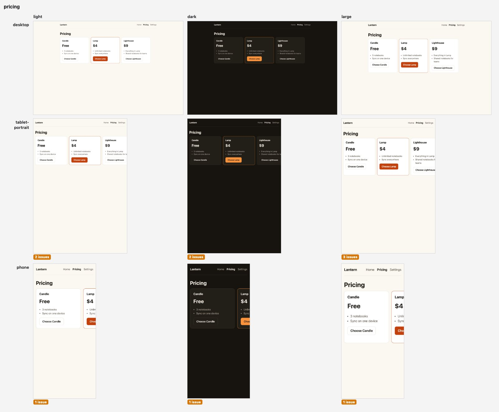

# facetshot

**See every screen of your app on every device, in light, dark and large text, in one command.**

facetshot takes pictures of web pages, iOS and Mac screens, Electron and Tauri windows, Storybook stories and SwiftUI
views across a grid of devices and display settings. You get back one contact sheet per screen and a short list of
what looks broken. It was built for AI coding agents, which need to _see_ a UI change before they can honestly say
it's done, and it works just as well from your own terminal.

```
$ facetshot /pricing --on desktop,tablet-portrait,phone --as light,dark,large
9/9 pictures · 1 screen · 3 devices × 3 variants · 2.2s (0.4s getting ready)

Sheets:
  .facetshot/runs/20261111-083644-cd15/pricing.sheet.jpg

Found (4):
  ✗ pricing [3 cells] overflow: The page is 68px wider than the screen, so it scrolls sideways. — div.plans > article.plan
  ✗ pricing [3 cells] overflow: The page is 498px wider than the screen, so it scrolls sideways. — div.plans > article.plan
  ! pricing [3 cells] clipped: Text off the right edge. "Shared notebooks for teams" — article.plan > ul > li
  ! pricing [tablet-portrait/large] clipped: Text off the right edge. "Lighthouse" — article.plan > button
```



That's [the example app](examples/vite-react) in this repository. Its pricing cards don't wrap, so on a tablet and a
phone they run off the screen. One look at the sheet shows it, and the list under the command says where.

> **Status: early (0.1).** facetshot isn't on npm yet, and its config may still change before 1.0. See [Installing before the npm release](#installing-before-the-npm-release).

## Why it exists

Checking a UI change properly means looking at it on a phone, a tablet and a desktop, in light and dark mode, with
large text. That's a dozen pictures per screen. Doing it by hand is tedious, and scripting it is worse: every script
has to solve signing in, test data, waiting for the page to finish loading and starting the right servers all over
again. Most of the time goes into getting ready rather than looking.

facetshot does the getting ready once and keeps it ready:

- **It keeps things warm.** A small background helper keeps the browser, your app's server and any simulators running
  between runs, so the second look takes seconds, not minutes.
- **It waits for the screen, not the clock.** It takes a picture once the network is quiet, fonts are loaded and
  spinners are gone, and never after a fixed sleep.
- **It reads the screen for you.** Alongside the pictures it checks for sideways scrolling, cut-off text, buttons
  hidden under something else, broken images, console errors and failed requests, so you know which picture to look at.
- **It's safe to run a lot.** Ten agents taking pictures at once still share one browser, two simulators and one build
  at a time, and they slow down when the machine is busy instead of piling on.

## How it compares

|                          | Visual testing services (Chromatic, Percy, Argos) | Playwright `toHaveScreenshot`  | facetshot                                                    |
| ------------------------ | ------------------------------------------------- | ------------------------------ | ------------------------------------------------------------ |
| Main question it answers | Did anything change since the approved version?   | Does this page match its file? | What does this screen look like everywhere, right now?       |
| Where it runs            | Their cloud, from CI                              | Your test suite                | Your machine, whenever you or an agent asks                  |
| What it covers           | Web, Storybook                                    | Web                            | Web, Storybook, iOS simulator, SwiftUI, Mac, Electron, Tauri |
| Output                   | A review web app                                  | Pass or fail per test          | Contact sheets, a list of problems, diffs, JSON              |
| Made for agents          | No                                                | No                             | MCP server and Agent Skill included                          |

facetshot doesn't replace visual regression testing in CI. It's the quick look you take while you work. Its
baselines and diffs are there for "what did my change do?", not for gating merges.

## Quick start

You need [Bun](https://bun.sh) 1.3+ or Node 22.6+. Web pages work on macOS, Linux and Windows. iOS, Mac and SwiftUI
need a Mac with Xcode.

```sh
npm i -D facetshot              # or: bun add -d facetshot
npx playwright install chromium
```

Then start from whichever of these fits:

**Any page on the web.** No config needed:

```sh
npx facetshot https://example.com --on phone,desktop
```

**Your own project.** Run `init` in the project's folder. It looks at what you already use (Vite, SvelteKit, Next.js,
Astro, Nuxt, Storybook, Electron, Tauri, Swift packages) and writes a `facetshot.config.ts` that builds and starts your
app:

```sh
npx facetshot init
npx facetshot / /settings
```

If the folder isn't a project it recognises, `init` writes nothing. It tells you what it looked for and what to do
next, so you never end up with a config that only fails later.

**An app that's already running.** Your dev server, staging or production:

```sh
npx facetshot init --url https://staging.example.com
npx facetshot /pricing /docs
```

Then let your coding agent use it by itself:

```sh
npx facetshot init --agent claude    # or cursor, codex, all
```

This registers facetshot's MCP server and adds a short skill that teaches the agent when and how to look.

## What you can point it at

| Write                                     | To see                                                                        |
| ----------------------------------------- | ----------------------------------------------------------------------------- |
| `/settings` or `https://…`                | a web page                                                                    |
| `app:/inbox`                              | an app screen, opened by deep link on an iOS simulator or in a desktop window |
| `story:button--primary`, `story:Button/*` | Storybook stories                                                             |
| `preview:Settings/Account`                | SwiftUI views rendered without launching the app                              |
| `flows/delete-account.yaml`               | a state you reach by clicking and typing                                      |

Choose devices with `--on` and display settings with `--as`. To click or type your way to a state first, use `--do`:

```sh
facetshot /settings --on phone,tablet-portrait --as light,dark,dark+large
facetshot /settings --do "click:text=Delete account" --do shot:confirm
facetshot check /settings /billing      # no pictures, just the list of problems
facetshot diff                          # the last command again: only what changed
```

## What you get back

Every run writes a folder with:

- **A contact sheet per screen** (`<screen>.sheet.jpg`): devices down the side, variants across the top. It's the
  one image to look at first.
- **The single pictures**, at full resolution, for when a cell needs a closer look.
- **`report.html`**: every sheet and problem on one page (`--open` opens it).
- **`manifest.json`**: everything that happened, for scripts and agents ([schema](schema/manifest.v1.json)).

The terminal shows a short summary by default. Use `--format md` for a pull request comment, or `--format json` for
the manifest itself. Agents using the MCP server get the summary and the sheets as images directly, sized to fit in
their context.

## Examples

Each folder in [`examples/`](examples) is a small app with a working config, and a few bugs left in on purpose for
the checks to find:

- [`vite-react`](examples/vite-react): a React app with Storybook
- [`electron`](examples/electron): an Electron app
- [`tauri`](examples/tauri): a Tauri app
- [`swiftui`](examples/swiftui): SwiftUI views rendered by FacetshotKit

## Documentation

- [Getting started](docs/getting-started.md): install, your first picture, your first config
- [How it works](docs/concepts.md): targets, devices, variants, profiles, runs and the background helper
- [Web apps](docs/web.md): builds and servers, live sites, signing in, test data, when a screen counts as ready
- [Flows](docs/flows.md): pictures of menus, dialogs and half-filled forms
- [Checks](docs/checks.md): what facetshot reads on each screen
- [Comparing](docs/comparing.md): what changed since the last run or a saved baseline
- [iOS simulators](docs/ios.md) and [SwiftUI snapshots](docs/swiftui.md)
- [Desktop apps](docs/desktop.md): native Mac apps, Electron and Tauri
- [Storybook](docs/storybook.md)
- [AI agents](docs/agents.md): the MCP server, the skill, and getting good results from an agent
- [Configuration reference](docs/configuration.md)
- [Command reference](docs/cli.md)
- [Speed and machine safety](docs/performance.md)
- [Troubleshooting](docs/troubleshooting.md)

## Platform support

|                                       | macOS                            | Linux   | Windows |
| ------------------------------------- | -------------------------------- | ------- | ------- |
| Web pages (Chromium, WebKit, Firefox) | ✓                                | ✓       | ✓       |
| Storybook                             | ✓                                | ✓       | ✓       |
| Electron                              | ✓                                | ✓       | ✓       |
| iOS simulator                         | ✓                                | —       | —       |
| SwiftUI snapshots                     | ✓                                | —       | —       |
| Native Mac windows                    | ✓                                | —       | —       |
| Tauri                                 | ✓ (window, and the UI in WebKit) | planned | planned |
| Android                               | planned                          | planned | planned |

Everything marked ✓ is tested on macOS. Web, Storybook and Electron use only Playwright, which runs the same way on
Linux and Windows, but they haven't been tried there yet. Reports are welcome.

## Installing before the npm release

Clone this repository and install its dependencies, then add it to your project from the folder:

```sh
git clone <this repository> facetshot
cd facetshot && bun install && cd -
bun add -d ./facetshot          # or: npm i -D ./facetshot
npx playwright install chromium
```

## Contributing

facetshot runs on Bun. From a clone:

```sh
bun install
bun test test              # unit and end-to-end tests (the Electron, Tauri and iOS ones skip what isn't installed)
bun --bun tsc --noEmit -p .
bun run lint               # Prettier
```

The code is laid out by job: `src/drivers/` has one file per platform, `src/checks/` reads the page, `src/output/`
makes sheets, diffs and reports, `src/engine/` handles builds, locks, servers and the background helper, and
`src/integrations/mcp.ts` is the MCP server. [How it works](docs/concepts.md) is the best map of the ideas behind it.

Please open an issue before a large change, so we can agree on the shape first.

## License

[MIT](LICENSE)
