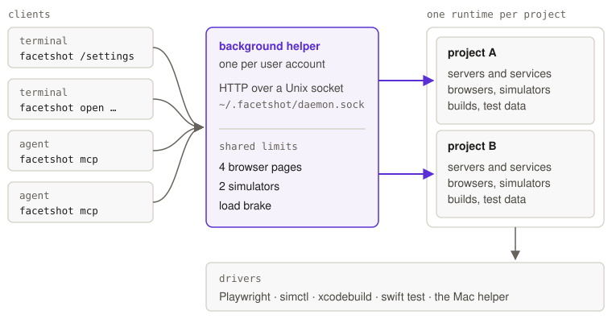

# Architecture

This page describes how facetshot's parts fit together. You don't need it to use facetshot; it is for people who
want to understand its behaviour, judge its security, or work on its code.

## The parts

1. The command line (`src/cli.ts`, sessions in `src/session-cli.ts`) and the MCP server (`src/integrations/mcp.ts`)
   turn what you asked for into a request. Neither takes screenshots itself.
2. They send it to the background helper (`src/daemon/server.ts`, client side in `src/daemon/client.ts`) over a Unix
   socket at `~/.facetshot/daemon.sock` (or under `FACETSHOT_HOME`). The protocol is HTTP. A run (`/run`) sends one
   JSON request and gets a stream of JSON lines back (progress, each finished screenshot, then the manifest); session
   calls (`/session/open`, `act`, `look`, `close`) are one JSON request and one JSON response; `/session/logs` streams
   JSON lines. If the helper isn't running, the client starts it.
3. The helper keeps one runtime per project (`src/engine/runtime.ts`): the browsers, the project's services and the
   web app's server, booted simulators, and test data.
4. Drivers (`src/drivers/`, one file per platform) do the work (see [the module map](#the-module-map)).
5. `src/output/` writes the results: contact sheets, comparisons, `report.html`, `summary.md` and the manifest.

With `--no-daemon` (or `FACETSHOT_NO_DAEMON`), the client runs the request in its own process with a runtime of its
own, and closes everything when the run ends. Sessions need the background helper, so they aren't available then.

## The life of a run

1. `cli.ts` (or `mcp.ts`) parses the request and calls `runViaDaemon` in `daemon/client.ts`, which makes sure a
   helper running the same code is up.
2. `daemon/server.ts` loads the config with the caller's environment (`config.ts`), finds or makes the project's
   runtime, and calls `run()` in `run.ts`.
3. `run.ts` asks `plan.ts` for the cells (targets × devices × variants, each target only on devices that can show
   it), starts services (`startServices`), makes test data (`fixtures.ts`), and hands each driver the cells it takes.
4. Each driver's `prepare` builds and starts what it needs (`engine/build.ts` decides whether a build is needed from
   its inputs; `engine/procs.ts` starts processes), then `shoot` takes the screenshots and reports each cell as it
   finishes.
5. `run.ts` writes the sheets, comparisons, logs and manifest, and the client prints the summary
   (`output/manifest.ts`).

## The module map

| Where                                | What                                                                                                                                                                               |
| ------------------------------------ | ---------------------------------------------------------------------------------------------------------------------------------------------------------------------------------- |
| `plan.ts`, `presets.ts`              | targets, devices, variants and profiles; the built-in devices, variants, groups and profiles                                                                                       |
| `run.ts`                             | one run, from plan to manifest; `newContext` and `startServices` are shared with sessions                                                                                          |
| `flows.ts`                           | the step grammar (`parseStep`, flow files) and playing steps in a page (`doStep`)                                                                                                  |
| `drivers/driver.ts`                  | the `Driver` interface (`handles`, `prepare`, `expand`, `shoot`) and helpers every driver uses                                                                                     |
| `drivers/index.ts`                   | the drivers, in the order they are asked whether they take a cell                                                                                                                  |
| `drivers/web.ts`, `page.ts`          | web pages through Playwright: readiness, checks, screenshots; shared by Storybook, Electron and Tauri's frontend                                                                   |
| `drivers/electron.ts`, `tauri.ts`    | Electron through Playwright; Tauri's frontend in WebKit and its real window                                                                                                        |
| `drivers/ios.ts`, `simctl.ts`        | iOS simulators, with the UI-test runner in `FacetshotRunner/` (built once with `xcodebuild`, then driven through numbered command files)                                           |
| `drivers/macos.ts`, `mac-ui.ts`      | Mac app windows: launching, capture, and steps through Accessibility. `playOnMac` plays a flow in a Mac window, whether facetshot launched a native Mac app or Tauri's real window |
| `drivers/mac-helper.swift`           | the Swift helper behind Mac windows: lists and captures a process's windows, reads and acts on them; compiled per source hash into `~/.facetshot/bin`                              |
| `drivers/swift.ts`, `FacetshotKit/`  | SwiftUI scenes drawn inside a test                                                                                                                                                 |
| `session.ts`, `surface.ts`           | sessions (below)                                                                                                                                                                   |
| `engine/`                            | the runtime, process groups and environments (`procs.ts`, `ownEnvironment`), builds and caches keyed by inputs, the static file server, locks and the pools (`scheduler.ts`)       |
| `checks/`, `logs.ts`                 | what is read on each page; logs, masking, and app output and system log recording                                                                                                  |
| `fixtures.ts`, `ports.ts`            | test data and its ledger; `stablePorts`                                                                                                                                            |
| `listing.ts`, `doctor.ts`, `init.ts` | `list`, `doctor`, `init` (and the agent files it writes, with `undoAgents`, their inverse)                                                                                         |
| `setup.ts`, `uninstall.ts`           | `setup` (browsers through facetshot's own Playwright) and `uninstall`                                                                                                              |

## Sessions

A session (`src/session.ts`) keeps the order of steps, the log since the last response, and the steps that worked.
What it opens is a `Surface` (`src/surface.ts`), an interface with two implementations:

- `PageSurface`: a page in a browser, an Electron window or Tauri's frontend, read through Playwright's accessibility
  snapshot.
- `MacSurface`: a Mac app's window (a native Mac app or Tauri's real window), read and worked through `mac-ui.ts`.

Each surface's `guard` says what a step holds while it runs: a slot in the browser pool for a page, or the Mac window
lock for a Mac window. The lock is held per step, not for the session's life.

## How to add a driver

1. Write a class that implements `Driver` (`src/drivers/driver.ts`): `handles` says which cells it takes, `prepare`
   gets ready, `shoot` reports every cell it was given.
2. Add it to `createDrivers()` in `src/drivers/index.ts`, before any driver that would also take its cells.
3. If its targets need a new kind or platform, add it to `PLATFORMS` in `plan.ts` and to the device presets.
4. Add a test under `test/` that skips cleanly when the platform's tools aren't installed.

## Tests

`bun test test` runs everything. Unit tests (`plan`, `cli`, `config`, `logs`, `lock`, `ports`, `static`) need nothing.
The end-to-end tests start a background helper in a temporary `FACETSHOT_HOME` and skip what the machine lacks:
Electron and Tauri skip when the example's dependencies aren't installed, and `mac.test.ts` checks the Screen
Recording and Accessibility permissions first and skips the parts it isn't allowed to do. There is no iOS simulator
test. An edit to any file in `src/` replaces the running background helper on the next request (see
[Lifecycle](#lifecycle)).

## Environment variables

The client sends its environment variables with every request. The helper evaluates the config file with them, so
`process.env` in the config is the caller's. What commands and apps facetshot starts get instead is described in
[Configuration](configuration.md#settings-that-differ-per-checkout-or-per-person).

A runtime is replaced when the values the config produces change (for example because an environment variable it
reads changed). Changes to files the config imports aren't noticed until the config file itself changes.

## Shared limits

The helper owns two pools: 4 browser pages being worked on at once, and 2 simulators. Every run and session from any
project takes its slots from them. A project's `limits` can narrow them for its own runs but not widen them. Without
the helper, a run makes pools of its own with the same ceilings.

Before work takes a slot, the pool checks the machine (the load brake). When the 1-minute load average is above 3
times the core count (`limits.maxLoad` changes this, without the helper only), or the system reports memory
pressure, work goes one at a time; when memory is critical, nothing new starts. The load check is skipped on Windows,
which has no load average.

Heavy builds and Mac window work also take machine-wide locks: folders in `~/.facetshot/locks/` created with `mkdir`,
which other checkouts and your own scripts can share ([`limits`](configuration.md#limits)). A lock whose holder has
died is taken over. Electron launches aren't locked across runs and sessions; see
[Desktop apps](desktop.md#electron).

## Lifecycle

- The helper starts on demand, the first time a client needs it, with the environment and the macOS permissions of
  the app that started it.
- It records which version of facetshot's code it runs (a hash of the source files' times). When a client runs
  different code, newer or older, the helper is stopped and replaced. If it is busy (a run in progress or a session
  open), the client runs the request in its own process instead, outside the shared limits, and the helper is
  replaced on a later run. A session can't be opened then; the client says the helper is busy.
- After 15 minutes without runs or sessions (`FACETSHOT_IDLE_MINUTES`), the helper stops. A project that hasn't been
  used for 15 minutes gives up its servers and browsers even while other projects keep the helper busy.
- An unused session closes after 10 minutes (`FACETSHOT_SESSION_IDLE_MINUTES`).
- Browsers are closed and started again every 25 runs. If the helper's own memory grows past 1.5 GB, it stops when it
  is next idle, and the next run starts a fresh one.
- Stopping has a 60-second deadline. Each step gets 10 seconds, servers are stopped before browsers, and whatever is
  still running when the helper exits is killed.

The helper writes its own log to `~/.facetshot/daemon.log`. [Security](security.md) lists every file facetshot
writes.
