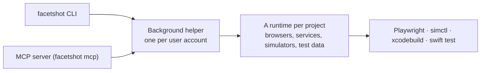

# Architecture

This page describes how facetshot's parts fit together. You don't need it to use facetshot; it is for people who
want to understand its behaviour, judge its security, or work on its code.

## The parts

1. The command line (`src/cli.ts`) and the MCP server (`src/integrations/mcp.ts`) turn what you asked for into a run
   request. Neither takes screenshots itself.
2. They send the request to the background helper (`src/daemon/`) over a Unix socket at `~/.facetshot/daemon.sock`
   (or under `FACETSHOT_HOME`). The protocol is HTTP: one JSON request in, a stream of JSON lines out (progress,
   each finished screenshot, then the manifest). If the helper isn't running, the client starts it.
3. The helper keeps one runtime per project (`src/engine/runtime.ts`): the browsers, the project's services and the
   web app's server, booted simulators, and test data. A runtime is replaced when the config file or the caller's
   environment changes.
4. Drivers (`src/drivers/`, one file per platform) do the work through Playwright for browsers and Electron, `simctl`
   and a small UI-test runner for iOS simulators, `xcodebuild` and `swift test` for SwiftUI scenes, and for Mac app
   windows (native apps and Tauri's real window) a small Swift helper (`mac-helper.swift`, compiled once into
   `~/.facetshot/bin`) that lists and captures a process's windows and reads and acts on them through macOS's
   Accessibility interface. `mac-ui.ts` turns steps into its commands, and `playOnMac` in `macos.ts` plays a flow in
   any Mac window, whoever launched the app.
5. The results are written by `src/output/`: contact sheets, comparisons, `report.html`, `summary.md` and the
   manifest. The checks that read each page are in `src/checks/`, logs in `src/logs.ts`. A session
   (`src/session.ts`) keeps the order of steps, the logs and the steps that worked; what it works is a surface
   (`src/surface.ts`): a page (web, Electron, Tauri's frontend) or a Mac window.

With `--no-daemon` (or `FACETSHOT_NO_DAEMON`), the client runs the request in its own process with a runtime of its
own, and closes everything when the run ends. Sessions need the background helper, so they aren't available then.

## Environment variables

The client sends its environment variables with every request. The helper evaluates the config file with them, so
`process.env` in the config is the caller's. Commands facetshot starts (builds, services, the web app's server) get
the helper's own environment, the one it was started with, plus the `env` the config gives them.

## Shared limits

The helper owns two pools: 4 browser pages being worked on at once, and 2 simulators. Every run and session from any
project takes its slots from them. A project's `limits` can narrow them for its own runs but not widen them. Without
the helper, a run makes pools of its own with the same ceilings.

Before work takes a slot, the pool checks the machine. When the 1-minute load average is above 3 times the core
count, or the system reports memory pressure, work goes one at a time; when memory is critical, nothing new starts.
The load check is skipped on Windows, which has no load average.

Heavy builds and Mac window captures also take machine-wide locks: folders in `~/.facetshot/locks/` created with
`mkdir`, which other checkouts and your own scripts can share ([`limits`](configuration.md#limits)). A lock whose
holder has died is taken over.

## Lifecycle

- The helper starts on demand, the first time a client needs it.
- It records which version of facetshot's code it runs. When a client runs newer code, the helper is stopped and
  replaced. If it is busy (a run in progress or a session open), the client runs the request in its own process
  instead, outside the shared limits, and the helper is replaced on a later run.
- After 15 minutes without runs or sessions (`FACETSHOT_IDLE_MINUTES`), the helper stops. A project that hasn't been
  used for 15 minutes gives up its servers and browsers even while other projects keep the helper busy.
- An unused session closes after 10 minutes (`FACETSHOT_SESSION_IDLE_MINUTES`).
- Browsers are closed and started again every 25 runs. If the helper's own memory grows past 1.5 GB, it stops when it
  is next idle, and the next run starts a fresh one.
- Stopping has a 60-second deadline. Each step gets 10 seconds, servers are stopped before browsers, and whatever is
  still running when the helper exits is killed.

The helper writes its own log to `~/.facetshot/daemon.log`. [Security](security.md) lists every file facetshot
writes.
